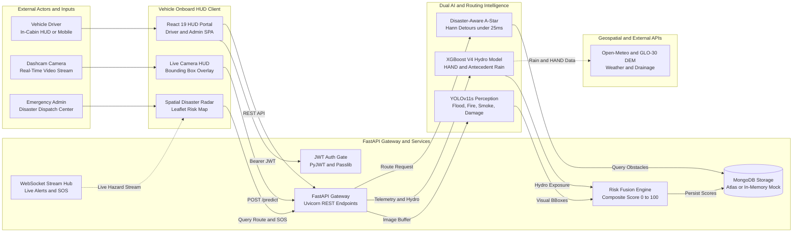

# Intelligent Vehicle Assistance During Disasters (DisasterShield ADAS)

An AI-powered automotive assistance framework and navigation service engineered to protect drivers and emergency teams during severe environmental disasters (flash floods, approaching wildfires, smoke plumes, and severe road pavement collapse). 

The platform unites **edge computer vision (YOLOv11s)**, **hydrologically grounded machine learning (XGBoost V4 with Copernicus GLO-30 HAND)**, and **disaster-aware dynamic A\* routing** inside a modern **React 19 Automotive HUD**.

---

## 📌 Key System Capabilities

- 🖼️ **Multi-Hazard Edge Vision**: Dashcam perception via **Ultralytics YOLOv11s** detecting 6 disaster categories (`Flood`, `Fire`, `Smoke`, `Person`, `Vehicle`, `Road Damage`), supplemented with a dedicated real-time nano tracker and optional SAHI multi-scale slicing.
- 🌊 **Hydrologically Grounded Risk Prediction**: 8-feature tree-boosted classifier (**XGBoost V4**) integrating European Space Agency (ESA) Copernicus GLO-30 Height Above Nearest Drainage (HAND) with antecedent precipitation (24h, 72h, 7d, and upstream catchment inflow), achieving **100% safety recall** on unseen road corridors.
- 🛣️ **Disaster-Aware Dynamic A\* Pathfinding**: Real-time graph routing incorporating Haversine heuristics, inverse-distance hazard proximity decay, and smooth **raised-cosine Hann-window lateral detours** computed in under 25 ms.
- 🚨 **Emergency SOS & Live Dispatch**: Instant SOS beacon dispatching GPS telemetry, driver information, and hazard observations to dispatchers via real-time WebSockets (`/ws/emergency`).
- 🗺️ **Spatial Disaster Radar**: Interactive Leaflet HUD mapping active risk radii, impassable road closures, and nearby humanitarian relief shelters.
- 🔐 **Role-Based JWT Security**: PyJWT and Passlib bcrypt authentication providing dedicated interfaces for Citizen Drivers and Command Center Admins.
- 🛡️ **Zero-Dependency Resilience**: MongoDB Atlas primary database with automatic, zero-dependency in-memory mock fallback when offline.

---

## 🏗️ System Architecture

Explore the standalone interactive runtime architecture diagram with dark/light themes and live animated signal traces:  
👉 **[Open Interactive Architecture Diagram](./.archify/architecture-adas-runtime-20261104-225800/adas-runtime.html)**



---

## 🛠️ Technology Stack

| Layer | Technologies |
| :--- | :--- |
| **Frontend** | React 19, Vite 8, Lucide React, Axios, Leaflet (CartoDB Dark Matter), Chart.js & React-ChartJS-2 |
| **Backend** | Python 3.12, FastAPI, Uvicorn, Pydantic v2, WebSockets, PyJWT, Passlib (bcrypt) |
| **Database** | MongoDB Atlas / PyMongo (with transparent in-memory mock fallback) |
| **Computer Vision** | Ultralytics YOLOv11s & YOLOv8n, OpenCV, CLAHE contrast enhancement, SAHI |
| **Machine Learning** | XGBoost 3.x, Scikit-Learn, NumPy, Pandas, SciPy |
| **Pathfinding** | Disaster-Aware A\* with Haversine distance heuristics & Hann raised-cosine lateral detours |
| **Geospatial & Hydro** | European Space Agency (ESA) Copernicus GLO-30 DEM, Open-Meteo ERA5 Reanalysis |

---

## 📁 Repository Structure

```
.
├── backend/                  # FastAPI 2.0 REST API & WebSocket Server
│   ├── app/
│   │   ├── api/              # Routers (Auth, Detections, Road Risk, Navigation, Emergency, Hazards, Weather)
│   │   ├── database/         # MongoDB Manager & In-Memory Collection Fallback
│   │   ├── models/           # Pydantic v2 schemas and validation models
│   │   ├── services/         # YOLOv11s engine, XGBoost V4, Risk Fusion, Disaster-Aware A*
│   │   └── main.py           # Application entry point & router registration
│   └── requirements.txt      # Backend Python dependencies
├── frontend/                 # React 19 + Vite 8 Automotive HUD Web App
│   ├── src/
│   │   ├── components/       # Camera HUD modal, live map, hazard alerts, navigation widgets
│   │   ├── context/          # AuthContext (Role management & JWT state)
│   │   ├── pages/            # Dashboard, Detection, RoadSafety, DisasterRadar, EmergencySOS, AdminControl
│   │   ├── services/         # Axios API clients, WebSocket listeners, route calculation
│   │   └── App.jsx           # Root layout and portal router
│   ├── package.json
│   └── vite.config.js        # Proxy configuration for /api and WebSockets
├── pipeline/                 # Dataset building, geospatial auditing, and ML pipelines
│   ├── train_and_evaluate_v4.py  # XGBoost V4 training & held-out road evaluation
│   ├── sahi_inference.py         # SAHI multi-scale slicing implementation
│   └── providers/                # Weather, disaster, road, and telemetry data providers
├── training/                 # Deep learning training scripts (YOLOv11, FloodNet, unified sets)
├── models/                   # Pretrained weights (best.pt, yolov8n.pt, road_risk_v4/)
├── scripts/                  # Accuracy benchmarks and verification scripts
│   ├── benchmark_sahi_accuracy.py # SAHI vs standard YOLO comparative evaluation
│   └── test_accuracy_boost.py    # Threshold calibration (tau = 0.65) benchmark
├── docs/                     # System architecture, database schemas, and model cards
│   ├── architecture.md       # Core architectural specification
│   ├── database.md           # MongoDB schemas and field definitions
│   ├── api_docs.md           # REST endpoint contracts
│   └── road_risk_v4_model_card.md # XGBoost V4 specifications and validation
└── README.md
```

---

## 🚀 Quick Start Guide

### 1. Prerequisites
- **Python:** `3.12+`
- **Node.js:** `18+` (npm `9+`)
- **Git**

---

### 2. Backend Setup & Startup

Open a terminal in the root directory:

```powershell
cd backend

# Option A: Windows PowerShell with existing virtual environment
.\.venv\Scripts\Activate.ps1
uvicorn app.main:app --reload --port 8000

# Option B: Fresh environment setup
python -m venv .venv
.\.venv\Scripts\Activate.ps1
pip install -r requirements.txt
uvicorn app.main:app --reload --port 8000
```

- **API Server:** `http://localhost:8000`
- **Interactive Swagger Docs:** `http://localhost:8000/docs`
- **Health Check:** `http://localhost:8000/api/health`

---

### 3. Frontend Setup & Startup

Open a second terminal:

```powershell
cd frontend

# Install Node dependencies
npm install

# Start Vite development server
npm run dev
```

- **Live HUD Dashboard:** `http://localhost:5173`

---

### 4. 🔑 Demo Credentials

The database automatically seeds operational test accounts upon launch:

| Role | Username | Password | Access & Capabilities |
| :--- | :--- | :--- | :--- |
| **Driver / Citizen** | `driver` | `driver123` | Live GPS Map, YOLOv11 Dashcam HUD, Inundation Risk Telemetry, Emergency SOS |
| **Command Admin** | `admin` | `admin123` | City-Wide Incident Command, Hazard Verification & Geo-Pinning, SOS Dispatch Queue |

---

## 📊 Machine Learning Benchmarks & Pipelines

### Reproducing Models & Evaluations

```powershell
# 1. Run XGBoost V4 Hydrological Model Training & Held-Out Road Test
.\.venv-ml\Scripts\python.exe pipeline/train_and_evaluate_v4.py

# 2. Run Decision Threshold Tuning (tau = 0.65)
.\.venv-ml\Scripts\python.exe scripts/test_accuracy_boost.py

# 3. Run SAHI Slicing vs Standard YOLO Detection Benchmark
.\.venv-ml\Scripts\python.exe scripts/benchmark_sahi_accuracy.py
```

### Audited Benchmark Summary

| Evaluation Dimension | Baseline System | DisasterShield ADAS Result | Performance Advantage |
| :--- | :---: | :---: | :---: |
| **Road Risk Recall (Unseen Roads)** | 60.0% (V2) | **100.0% (0 False Negatives)** | Zero critical hazards missed |
| **Road Risk Calibrated Accuracy** | 50.0% (V2) | **94.44% (tau = 0.65)** | +44.44% generalization gain |
| **Visual Disaster mAP@0.5** | — | **71.64%** (YOLOv11s, 50 epochs) | Robust multi-hazard classification |
| **Small Object Yield (SAHI)** | Baseline Single-Pass | **+66.7% to +100% Recall** | Distant aerial & dashcam obstacles |
| **Algorithmic Latency** | — | **28.54 ms Total** | Real-time edge execution (35+ FPS) |

---

## 📚 Open Datasets & References

- 🌊 **FloodNet Dataset**: [FloodNet Challenge (BinaLab)](https://github.com/BinaLab/FloodNet-Challenge-EARTHVISION2021) | [arXiv:2012.02951](https://arxiv.org/abs/2012.02951)
- 🔥 **FLAME Wildfire Aerial Dataset**: [IEEE Access](https://doi.org/10.1109/ACCESS.2021.3082857) | [arXiv:2012.03062](https://arxiv.org/abs/2012.03062)
- 🛣️ **RDD2022 Road Damage Dataset**: [IEEE T-ITS](https://doi.org/10.1109/TITS.2022.3213524) | [arXiv:2209.08538](https://arxiv.org/abs/2209.08538)
- 🛰️ **Copernicus GLO-30 DEM**: [European Space Agency Copernicus Data Space](https://dataspace.copernicus.eu/)
- 🌲 **XGBoost System**: [ACM SIGKDD](https://doi.org/10.1145/2939672.2945399) | [arXiv:1603.02754](https://arxiv.org/abs/1603.02754)
- 👁️ **Ultralytics YOLOv11**: [Ultralytics Official Documentation](https://docs.ultralytics.com/models/yolo11/)

---

## 📄 Documentation Links

For deep dives into architectural contracts and data schemas:
- 🏛️ [System Architecture Guide](./docs/architecture.md)
- 🗄️ [Database Schemas & Collections](./docs/database.md)
- 📡 [API Endpoints Specification](./docs/api_docs.md)
- 🧪 [XGBoost V4 Model Card & Feature Contracts](./docs/road_risk_v4_model_card.md)
- 🏋️ [Model Training & Dataset Pipeline Guide](./docs/training_guide.md)

---

## ⚖️ License

This project is licensed under the MIT License.
