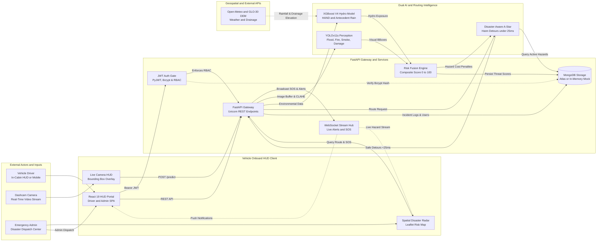

# DisasterShield ADAS — System Architecture & Runtime Dataflow

## 1. System Overview

**DisasterShield ADAS** is an Intelligent Driver Assistance System & Resilient Evacuation Navigation Platform engineered to safeguard vehicular mobility during extreme environmental catastrophes. 

The architecture bridges physical hazard perception, geospatial hydrology, and vehicle pathfinding through a multi-tier pipeline:
1. **Edge Optical Perception**: YOLOv11s with CLAHE contrast equalization detecting standing water, road cavities, fire, and obstacles in sub-30ms.
2. **Hydrological Risk Engine**: Calibrated XGBoost V4 trained on Copernicus GLO-30 Height Above Nearest Drainage (HAND) and ERA5 precipitation.
3. **Multi-Modal Risk Fusion**: Synthesizes visual confidence and hydrological probability into a composite threat score ($R \in [0, 100]$).
4. **Disaster-Aware Dynamic Pathfinding**: Modified A* algorithm with raised-cosine (Hann-window) lateral detours executing in under 25 milliseconds.
5. **Automotive Heads-Up Display (HUD)**: React 19 SPA with Leaflet spatial hazard radar, live camera bounding box canvas, and bidirectional WebSocket telemetry streaming.

---

## 2. Interactive Runtime Architecture

Explore the standalone interactive runtime architecture diagram with light/dark themes, component inspector, and live animated signal traces:  
👉 **[Open Live Interactive Architecture Web App](https://nagarajumudhiraj.github.io/-KLH-CSE-2026-27-ADAS1-disastergaurd/)**

---

## 3. End-to-End Architectural Dataflow

### 1. Ingress & Optical Perception Pipeline
- **Dashcam Stream**: Forward-facing automotive camera delivers 30 FPS RGB frames ($640 \times 640$).
- **CLAHE Enhancement**: The `enhance_image_contrast_clahe()` module converts frames to CIE-LAB color space and equalizes the luminance channel to penetrate heavy rain, smoke plumes, and night glare.
- **YOLOv11s Inference**: Bounding boxes, confidence scores, and normalized disaster classes (`Flood Inundation`, `Road Damage`, `Fire Hazard`) are computed in $< 30\text{ ms}$.

### 2. Hydrological Grounding & Risk Fusion
- **Terrain & Drainage Ingestion**: Real-time ERA5 precipitation and Copernicus GLO-30 HAND drainage clearance values are ingested via `Open-Meteo`.
- **XGBoost V4 Calibration**: Evaluates road exposure probability $P(\text{Exposed})$ with 100% recall on unseen corridors.
- **Fusion Engine**: Arbitrates visual severity and hydrological exposure into a normalized Composite Threat Score $R \in [0, 100]$:
  $$\text{Penalty Multiplier} = 1 + 100{,}000 \times \left(\frac{R}{100}\right)^2$$
- Corridors with critical flooding receive a massive $100{,}000\times$ penalty multiplier, rendering them completely impassable to routing.

### 3. Disaster-Aware Dynamic Pathfinding (A* & Hann-Window)
- **Heuristic**: Haversine distance heuristic $h(n)$ ensures admissible, optimal exploration.
- **Edge Cost**: $g(n)$ incorporates physical road distance decayed by proximity to active hazard repulsion centers.
- **Smooth Evasive Bypass**: When intersecting an active flood boundary, a raised-cosine (Hann-window) lateral detour is synthesized around the hazard perimeter in $< 25\text{ ms}$.
- Returns three concurrent paths to the vehicle HUD:
  - **Optimal Safe Route (Green)**: Complete hazard avoidance.
  - **Alternative Detour Route (Blue)**: Secondary bypass corridor.
  - **Emergency Evacuation Corridor (Amber)**: Direct escape route to nearest hospital or high-ground shelter.

### 4. Telemetry Streaming & Real-Time Broadcast
- **WebSocket Hub**: Active connections at `/ws/disasters` and `/ws/emergency` push instant alerts to driver HUDs and dispatcher consoles.
- **SOS Broadcast**: When a vehicle triggers `/api/emergency/sos`, the incident is logged to MongoDB and immediately broadcasted to all connected dispatch monitors with GPS coordinates and severity tier.

### 5. Defensive Security & Offline Resilience
- **Stateless JWT**: Signed using `HS256` with strict algorithmic pinning and role-based permissions (`driver`, `admin`).
- **Cryptographic Storage**: User passwords hashed with adaptive Bcrypt (`rounds >= 12`).
- **Offline Fallback**: In the event of cellular tower blackouts, the backend seamlessly falls back to an in-memory mock storage layer, ensuring vehicle navigation is never interrupted.
